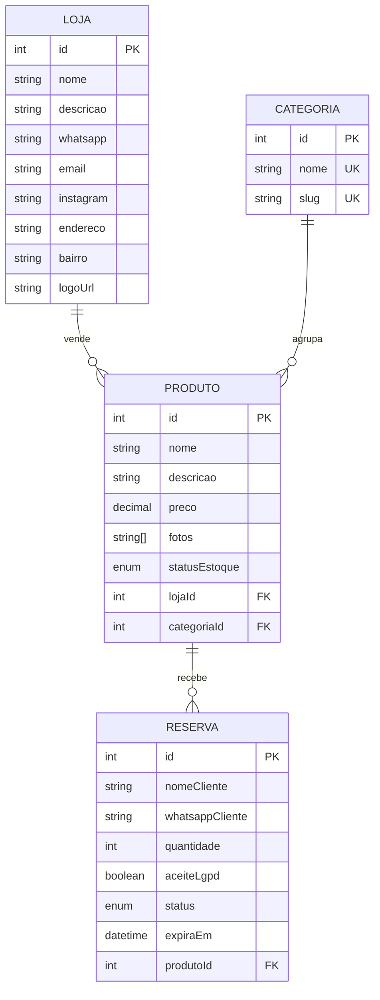
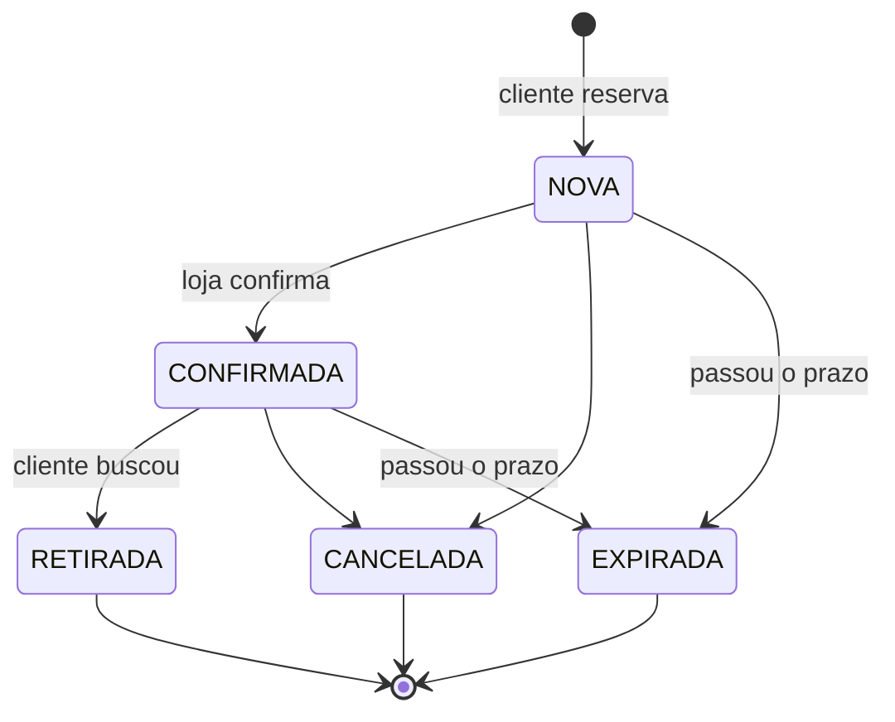

# 02 — Modelagem do banco e módulos da API (CRUDs)

> ⚠️ **Atualizado em 24/10:** o banco e os filtros mudaram para o formato do front (tabela de bairros, horários, slugs, busca com `q` e relevância). Este doc mostra a **primeira versão**; o que mudou está no [doc 07](07-integracao-com-o-front.md).

> **Issue:** [#11 — Back-end Módulos Principais da API (CRUDs)](https://github.com/pedroezequiellima/Ache-em-Petrolina/issues/11)
> Inclui a parte "[Back-end/DB] Modelagem do Banco" da [#6](https://github.com/pedroezequiellima/Ache-em-Petrolina/issues/6)
> **Branch:** `feat/backend-modules` (criada a partir de `feat/backend-init`)

## Objetivo

Criar as tabelas do banco e os módulos da API que o front precisa:

| Tela / fluxo do front | O que a API entrega |
|---|---|
| Tela inicial: busca por termo, filtro por bairro e categoria (#9) | `GET /produtos?q=&bairro=&categoria=` e `GET /categorias` |
| Detalhes do produto: fotos, preço, localização, "Falar com a loja" (#9) | `GET /produtos/:id` já traz a loja com endereço, bairro e WhatsApp |
| Formulário de reserva: Nome, WhatsApp, Quantidade + LGPD (#10) | `POST /reservas` com validação de todos os campos |

---

## 1. Modelagem do banco



**Relacionamentos (1 para N):**
- Uma **loja** tem vários **produtos**.
- Uma **categoria** tem vários **produtos**.
- Um **produto** tem várias **reservas**.

**Enums (valores fixos):**
- `StatusEstoque`: `DISPONIVEL`, `POUCAS_UNIDADES`, `ESGOTADO`
- `StatusReserva`: `NOVA`, `CONFIRMADA`, `RETIRADA`, `CANCELADA`, `EXPIRADA`

**O que acontece ao apagar (`onDelete`):**

| Ao apagar... | Acontece | Por quê |
|---|---|---|
| Loja | Apaga os produtos e as reservas dela (`Cascade`) | Produto sem loja não faz sentido |
| Categoria com produtos | **Bloqueado** (`Restrict`, erro 409) | Não deixar produto "órfão" de categoria |

**Detalhes de projeto:**
- `preco` é `Decimal(10,2)` e não `Float`: `Float` tem erro de arredondamento (0.1 + 0.2 = 0.30000000000000004), o que é inaceitável para dinheiro.
- `slug` é a versão do nome para URL ("Moda Feminina" vira `moda-feminina`). O front filtra com `?categoria=moda-feminina`, sem acento nem espaço.
- `whatsapp` é guardado só com números (`5587999999999`), formato que o link `wa.me` exige.
- Índices (`@@index`) em `bairro`, `lojaId`, `categoriaId`, `produtoId` e `status`, as colunas mais usadas nos filtros, para as buscas ficarem rápidas.
- `@@map("lojas")` deixa as tabelas com nome plural e minúsculo no banco, o padrão SQL.

**Comandos:**
```bash
npx prisma migrate dev --name init   # cria a migration e aplica no banco
npx prisma generate                  # gera o Prisma Client atualizado
```
A migration gerada fica em `prisma/migrations/<data>_init/migration.sql`. É o SQL de verdade, versionado no Git, então todo mundo do grupo (e o servidor) cria o banco igual.

---

## 2. Estrutura de um módulo

Os módulos foram gerados com o Nest CLI:
```bash
npx nest g resource lojas --no-spec --type rest --crud
```
Isso cria a pasta com todos os arquivos e já registra o módulo no `AppModule`. Exemplo do módulo de produtos:

```
src/produtos/
├── produtos.module.ts         # Junta controller + service
├── produtos.controller.ts     # Rotas HTTP (o "garçom")
├── produtos.service.ts        # Regras + acesso ao banco (o "cozinheiro")
└── dto/
    ├── create-produto.dto.ts      # Campos e validações para criar
    ├── update-produto.dto.ts      # Igual ao create, mas tudo opcional (PartialType)
    ├── filtro-produtos.dto.ts     # Filtros aceitos na query string
    └── atualizar-estoque.dto.ts   # Só o status de estoque
```

**O caminho de uma requisição:**
```
Front ──HTTP──▶ Controller ──▶ ValidationPipe (valida o DTO) ──▶ Service ──▶ PrismaService ──▶ PostgreSQL
                    ◀──────────────────── JSON ◀────────────────────┘
```

Removemos a pasta `entities/` que o CLI gera: com Prisma, os tipos das tabelas já vêm prontos do Prisma Client.

---

## 3. Os módulos

### Lojas — `/lojas`
| Método | Rota | Descrição |
|---|---|---|
| POST | `/lojas` | Cadastrar loja |
| GET | `/lojas?bairro=centro` (slug, ver doc 07) | Listar (filtro de bairro opcional), com a contagem de produtos |
| GET | `/lojas/:id` | Perfil da loja **com os produtos dela** |
| PATCH | `/lojas/:id` | Editar dados / contato |
| DELETE | `/lojas/:id` | Remover |

### Categorias — `/categorias`
Não estava na issue #11, mas o front filtra por categoria e a #6 cita a tabela.
| Método | Rota | Descrição |
|---|---|---|
| POST | `/categorias` | Criar (o slug é gerado sozinho a partir do nome) |
| GET | `/categorias` | Listar, com a contagem de produtos (para montar o filtro do front) |
| GET / PATCH / DELETE | `/categorias/:id` | Ver / editar / remover |

### Produtos — `/produtos`
| Método | Rota | Descrição |
|---|---|---|
| POST | `/produtos` | Cadastrar |
| GET | `/produtos` | Catálogo com **filtros combináveis** (abaixo) |
| GET | `/produtos/:id` | Detalhes + loja (endereço, bairro, WhatsApp) + categoria |
| PATCH | `/produtos/:id` | Editar |
| PATCH | `/produtos/:id/estoque` | Mudar só o status de estoque |
| DELETE | `/produtos/:id` | Remover |

**Filtros do `GET /produtos`:**

| Parâmetro | Exemplo | Como funciona |
|---|---|---|
| `q` | `vestido` | Busca por termo com relevância, sem acento (ver doc 07; antes se chamava `busca`) |
| `bairro` | `Centro` | Bairro da loja |
| `categoria` | `moda-feminina` | Slug da categoria |
| `lojaId` | `1` | Produtos de uma loja |
| `statusEstoque` | `DISPONIVEL` | Situação do estoque |
| `precoMin` / `precoMax` | `50` / `200` | Faixa de preço |

Exemplo: `GET /produtos?q=vestido&bairro=centro&precoMax=150`. A lista completa de filtros está no [doc 07](07-integracao-com-o-front.md).

### Reservas — `/reservas`
| Método | Rota | Descrição |
|---|---|---|
| POST | `/reservas` | Criar (o formulário do front) |
| GET | `/reservas?status=NOVA&lojaId=1` | Listar (para a loja ver os pedidos) |
| GET | `/reservas/:id` | Ver uma reserva |
| PATCH | `/reservas/:id/status` | Mudar o status |

Não existe `DELETE`: reserva não se apaga, só muda de status. Assim fica o histórico.

---

## 4. Regras de negócio (ficam no Service)

### Ciclo de vida da reserva


| Regra | Comportamento |
|---|---|
| Transições de status | Só as setas do diagrama são permitidas. Ex: `RETIRADA → CANCELADA` retorna **400** |
| Produto esgotado | Não aceita reserva (**400**) |
| LGPD | `aceiteLgpd` precisa ser `true` (**400**) |
| Prazo | Cada reserva vale **24h** (configurável em `RESERVA_VALIDADE_HORAS` no `.env`) |
| Expiração | Antes de listar ou consultar, reservas `NOVA`/`CONFIRMADA` vencidas viram `EXPIRADA` automaticamente |

---

## 5. Validação (DTOs + class-validator)

Cada campo do DTO tem decorators que dizem o que é aceito:
```ts
@Matches(/^\d{10,13}$/, { message: 'whatsappCliente deve ter só números, com DDD' })
whatsappCliente: string;
```

O `ValidationPipe` global (em `main.ts`) aplica isso em **todas** as rotas:
- `whitelist`: remove campos que não estão no DTO.
- `forbidNonWhitelisted`: e retorna erro se alguém mandar campo extra (proteção contra enviar `"status":"RETIRADA"` na criação, por exemplo).
- `transform`: converte a query string (`?lojaId=1` chega como texto `"1"` e vira o número `1`).

Exemplo de resposta com dados inválidos:
```json
{
  "message": [
    "property hacker should not exist",
    "nomeCliente should not be empty",
    "whatsappCliente deve ter só números, com DDD",
    "quantidade must not be less than 1"
  ],
  "error": "Bad Request",
  "statusCode": 400
}
```

## 6. Tratamento de erros do banco

Criamos o `PrismaExceptionFilter` (`src/common/filters/`), que transforma os erros do Prisma em respostas HTTP claras em vez de um "500 Internal Server Error" genérico:

| Erro do Prisma | Situação | Resposta |
|---|---|---|
| `P2025` | ID não existe | **404** Registro não encontrado |
| `P2002` | Valor duplicado (ex: categoria com mesmo nome) | **409** Já existe |
| `P2003` | Chave estrangeira (loja inexistente, categoria em uso) | **409** Relacionado não existe / em uso |

## 7. Swagger: documentação automática

Acesse **http://localhost:3001/docs** com a API rodando. Lá aparecem todas as rotas, os campos, os exemplos, e dá pra **testar direto pelo navegador** (botão "Try it out"). É ótimo para a apresentação e para o pessoal do front ver o formato dos dados.

Cada campo dos DTOs tem um `@ApiProperty({ example, description })`, que é o que aparece no Swagger.

> No começo usávamos o **plugin** do `@nestjs/swagger`, que lê os DTOs sozinho. Ele quebrou no monorepo (conflito entre o TypeScript 5 do front e o 6 do back) e foi trocado pelos decorators explícitos. Ver doc 07, problema 5.

## 8. CORS

`app.enableCors({ origin: FRONTEND_URL })` no `main.ts` libera **só o endereço do front** (Next.js, porta 3000) para chamar a API pelo navegador. Sem isso, o navegador bloqueia as requisições.

---

## 9. Testes

**Unitários** (`npm test`): 15 testes nesta primeira versão (23 depois do doc 07), com o Prisma "mockado" (simulado, sem banco):
- `reservas.service.spec.ts`: prazo de 24h, bloqueio de produto esgotado, 3 transições permitidas, 4 transições bloqueadas, expiração automática.
- `slugify.spec.ts`: geração de slug com acentos e símbolos.
- `app.controller.spec.ts`: rotas `/` e `/health`.

**Manuais** (com a API rodando e o banco real): testamos via `curl` todas as rotas, os filtros e todos os casos de erro da tabela acima. O arquivo [`requests.http`](../requests.http) tem essas requisições prontas para rodar no VS Code (extensão **REST Client**). Dá pra usar na apresentação.

---

## Problemas encontrados (e como resolvemos)

| # | Problema | Causa | Solução |
|---|---|---|---|
| 1 | Build quebrou com *Property 'reserva' does not exist on type 'PrismaService'* depois da migration | No **Prisma 7** o `migrate dev` **não roda mais o `generate` sozinho** (nas versões antigas rodava) | Rodar `npx prisma generate` depois de cada mudança no schema |
| 2 | Categoria "Eletrônicos" gerou o slug `eletr-nicos` nos testes com `curl` | O terminal do Windows enviou o acento num encoding diferente de UTF-8 | Não era bug da API: enviando o JSON em UTF-8, o slug sai `eletronicos`. O navegador/front sempre envia UTF-8 |
| 3 | O preço volta como texto (`"preco": "129.9"`) | É assim que o Prisma serializa `Decimal` em JSON, para não perder precisão | O front converte com `Number(produto.preco)` na hora de exibir |

## Decisões tomadas

| Decisão | Motivo |
|---|---|
| IDs numéricos (`autoincrement`) | Simples de ler e testar (`/produtos/1`). Dá pra trocar por UUID depois se precisar |
| Estoque como status (enum), não quantidade | A issue pede Disponível / Poucas unidades / Esgotado |
| Expiração verificada nas consultas | Não precisa de agendador (cron) rodando; simples e suficiente para o MVP |
| Modelagem do banco junto com a #11 | Os CRUDs dependem do schema; evita retrabalho |
| Sem paginação por enquanto | Poucos produtos no MVP; fácil de adicionar se o catálogo crescer |

## Próximos passos
- ~~Seed com 5 lojas e 15 produtos de Petrolina (#6).~~ Feito com os 8 lojas e 30 produtos do front (doc 07).
- Ajustar campos/filtros conforme o front for integrado.
- Autenticação para as rotas de gestão da loja (criar/editar produtos, mudar status de reserva), que hoje estão abertas.
